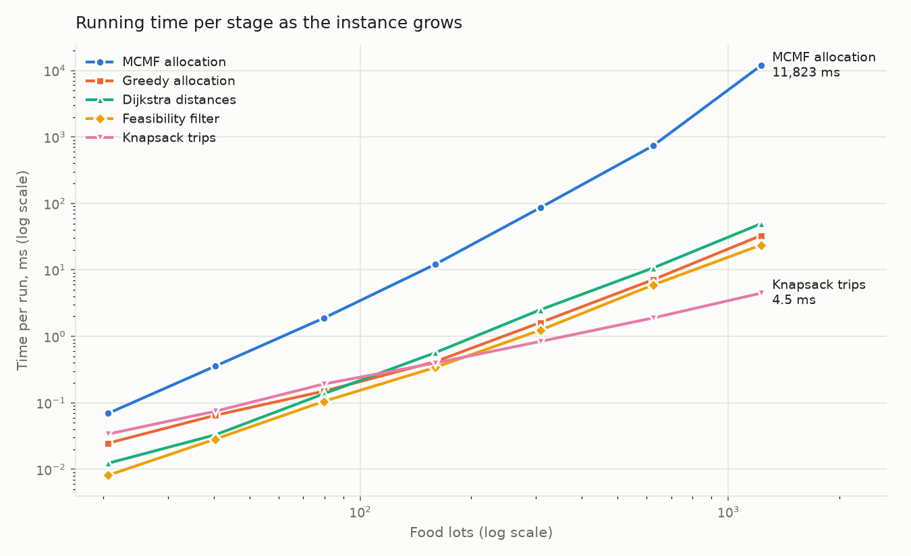
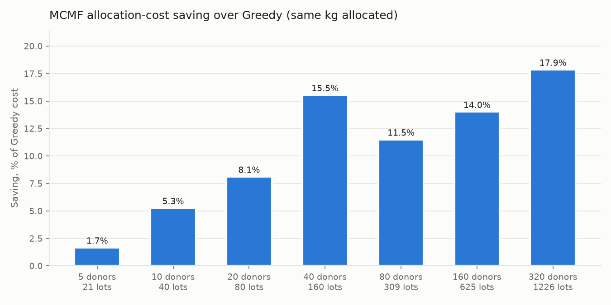

# FoodLoop – Complexity and Scalability Analysis (Day 6)

## 1. Notation

| Symbol | Meaning |
|---|---|
| `J`, `R` | road junctions, roads |
| `D`, `N` | donors, NGOs |
| `L` | food lots |
| `M` | (NGO, category) demand nodes in a tier's network, at most `3N` |
| `V`, `E` | nodes and edges of one tier's flow network: `V = L_t + M + 2`, `E ≤ L_t + L_t·M + M` |
| `F` | kg pushed in a tier (total flow) |
| `P` | augmenting paths found in a tier (`P ≤ F`) |
| `n`, `W` | crates waiting for one destination, vehicle capacity (kg) |

## 2. Theoretical complexity of each stage

| Stage | Algorithm | Time | Space | Why |
|---|---|---|---|---|
| Distances | Dijkstra with a binary heap, once per donor | `O(D · (J + R) log J)` | `O(J + R)` | Each run pushes at most one heap entry per relaxation; stale entries are skipped (lazy deletion) |
| Feasibility | Check every (lot, NGO) pair | `O(L · N)` | `O(L · N)` | Category, reachability and expiry are O(1) per pair after Dijkstra |
| Expiry ranking | Greedy sort (Earliest Deadline First) | `O(L log L)` | `O(L)` | One comparison sort |
| Allocation | MCMF, Successive Shortest Paths + Bellman-Ford, per tier | `O(P · V · E)` ≤ `O(F · V · E)` | `O(V + E)` | One Bellman-Ford search (`O(V·E)`) per augmenting path; each path pushes ≥ 1 kg |
| Vehicle loading | 0/1 Knapsack DP, per trip | `O(n · W)` per trip | `O(n · W)` | DP table of crates × capacity, kept for the traceback |
| Baseline | Greedy allocation | `O(L log L + Σ_k N_k log N_k)` ≤ `O(L · N log N)` | `O(L · N)` | Sort the lots, then sort each lot's feasible NGOs by distance once |

**Why MCMF dominates.**
- In a city of fixed area, a constant share of (lot, NGO) pairs stays feasible, so `E` grows like `L · N`.
- With `N ∝ L`, that makes `E ∝ L²` and `V ∝ L`.
- The number of augmenting paths `P` also grows with `L`.
- The bound `P · V · E` therefore grows roughly like `L⁴`.

In practice Bellman-Ford stops as soon as a full pass changes nothing, and that happens after a few passes rather than `V − 1`. So the measured growth is much lower than the bound (see §4).

**Polynomial, not exponential.** Every stage is polynomial, and MCMF returns an **exact** optimum for each tier. By contrast:
- the vehicle-routing formulation (Dubey and Tanksale) is NP-hard, which is why they use a Genetic Algorithm;
- exact 0/1 Knapsack is pseudo-polynomial (`O(n · W)`), which is tractable here because `W ≤ 120 kg`.

## 3. Experiment set-up

`python tools/run_scalability.py` generates instances at 7 sizes, from 5 to 320 donors, with NGOs = 1.25 × donors and 3 seeds per size, and times every stage inside the engine.
- **Fixed city area** (about 22.5 km × 22.5 km). This keeps the share of expiry-feasible pairs roughly constant, so the flow network really grows with size. This is the demanding case for MCMF.
- **Timing method.** Each stage is timed with the C++ `steady_clock` and repeated until at least 50 ms have been measured, because the MinGW clock ticks only about once per millisecond.
- **Output files:**
  - `results/day6_scalability.md` (all tables)
  - `results/day6_scalability_runs.csv` (raw rows)
  - `results/day6_scalability_time.png`
  - `results/day6_scalability_cost.png`

| Donors | NGOs | Lots L | Feasible pairs | Largest tier V / E | Flow F (kg) | Augmenting paths P |
|---|---|---|---|---|---|---|
| 5 | 6 | 21 | 85 | 28 / 73 | 282 | 30 |
| 20 | 25 | 80 | 1,645 | 110 / 1,016 | 1,176 | 139 |
| 80 | 100 | 309 | 25,436 | 428 / 14,439 | 4,660 | 569 |
| 320 | 400 | 1,226 | 398,474 | 1,681 / 218,632 | 17,880 | 2,343 |

## 4. Measured running time

| Donors | Lots | Dijkstra | Feasibility | **MCMF** | Knapsack trips | Greedy allocation | MCMF ÷ Greedy |
|---|---|---|---|---|---|---|---|
| 5 | 21 | 0.012 ms | 0.008 ms | **0.07 ms** | 0.034 ms | 0.025 ms | 3× |
| 10 | 40 | 0.033 ms | 0.028 ms | **0.36 ms** | 0.075 ms | 0.065 ms | 5× |
| 20 | 80 | 0.14 ms | 0.11 ms | **1.9 ms** | 0.19 ms | 0.15 ms | 13× |
| 40 | 160 | 0.57 ms | 0.34 ms | **12 ms** | 0.40 ms | 0.42 ms | 29× |
| 80 | 309 | 2.5 ms | 1.2 ms | **86 ms** | 0.84 ms | 1.6 ms | 53× |
| 160 | 625 | 10.7 ms | 5.9 ms | **739 ms** | 1.9 ms | 7.1 ms | 104× |
| 320 | 1,226 | 49 ms | 24 ms | **11.8 s** | 4.5 ms | 33 ms | 360× |

### Growth exponents: theory vs measurement

The empirical exponent `k` in `time ∝ L^k` comes from a log-log least-squares fit over 20–320 donors.

| Stage | Theory, in terms of L (with D, N, J ∝ L) | Predicted k | **Measured k** |
|---|---|---|---|
| Dijkstra | `D · (J + R) log J` → `L² log L` | ≈ 2 + | **2.15** |
| Feasibility | `L · N` → `L²` | 2 | **2.00** |
| Greedy allocation | dominated by scanning the `L · N` feasible pairs | 2 | **1.99** |
| Knapsack trips | crates ∝ F ∝ L, `W` constant → `L` | 1 | **1.15** |
| MCMF bound | `P · V · E` → `L · L · L²` | 4 | bound grows with k = **3.98** |
| **MCMF actual** | `P × (Bellman-Ford passes) × E` | 3 if the number of passes is constant | **3.16** |

The building blocks behave as the analysis says: feasible pairs (≈ E) grow with k = 2.01, flow F with k = 1.01, and augmenting paths P with k = 1.04.

**Reading the results.**
1. **Every stage except MCMF matches its theoretical class almost exactly.** Their k is within 0.15 of the prediction.
2. **MCMF grows like L³, one order below its worst-case bound.**
   - The `O(V·E)` cost of one Bellman-Ford search assumes `V − 1` passes.
   - The implementation stops as soon as a pass changes nothing. Shortest paths in this layered network (S → lot → NGO → T, plus a few reverse detours) are short, so only a handful of passes are needed.
   - That removes the factor `V`. What is left is `P × E ≈ L × L² = L³`.
   - The extra 0.16 above 3 comes from a slowly growing number of passes (more reverse-edge detours in bigger networks) and from cache effects. The largest network has 218,632 edges per tier.
3. **Practical limits.**
   - Up to 160 donors and 625 lots, MCMF finishes in under a second.
   - At 320 donors and 1,226 lots it needs about 12 s, which is still fine for planning a day's redistribution.
   - Greedy stays in milliseconds at every size, 360× faster at the top.

## 5. What the extra time buys

On every instance both methods allocated **exactly the same kg**. MCMF's saving is in transport cost, and it grows with size:

| Donors | 5 | 10 | 20 | 40 | 80 | 160 | 320 |
|---|---|---|---|---|---|---|---|
| Allocation-cost saving vs Greedy | 1.7% | 5.3% | 8.1% | 15.5% | 11.5% | 14.0% | **17.9%** |
| Trip-cost saving vs Greedy | −1.3% | 11.5% | 3.1% | 16.9% | 14.3% | 17.0% | **23.6%** |

**Why the saving grows.** More donors and NGOs mean more alternative routes. Greedy commits to the nearest NGO lot by lot and never reconsiders. MCMF uses reverse edges to re-route earlier choices, and the room for that grows with the network.

**Trade-off in one line:** MCMF spends 3×–360× more computation to cut transport cost by 2–18%. Both run in well under a minute at city scale.

The single negative trip-cost value (5 donors, −1.3%) shows that the per-kg allocation cost and the per-trip vehicle cost are different measures. MCMF minimises the first; the trip planner (section 7 of `problem_formulation.md`) determines the second.

## 6. Possible optimisation (not implemented)

Replace Bellman-Ford with **Dijkstra on reduced costs** (Johnson potentials):
- Each search becomes `O(E log V)` instead of `O(V · E)`.
- The algorithm and its optimal results are unchanged.
- MCMF time would become roughly `O(P · E log V)` ≈ `L³ log L` in the worst case. Given the early exit already observed, it would mainly lower the constant.

It is left as future work. The current version is fast enough for the project's scale, and Bellman-Ford keeps the negative-cost reverse edges easy to explain.
