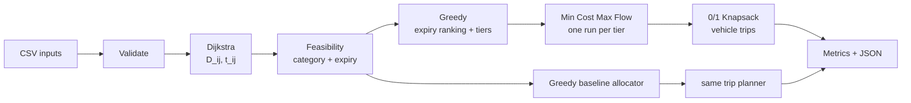

# FoodLoop – Problem Formulation and Methodology

## 1. Problem statement

Donors (restaurants, supermarkets, hostels, event organisers) have surplus food lots. NGOs (orphanages, shelters, food banks, community kitchens) need food in specific categories. FoodLoop turns donations and requests into an **allocation plan** and a **delivery plan**. It redistributes as much food as possible before it expires, at the lowest transport cost.

## 2. Workflow

This is the order the stages run in, as implemented in `cpp/src/main.cpp`:

| # | Step | Code | Algorithm |
|---|---|---|---|
| 1 | Load donor, NGO, lot, vehicle and road datasets | `loadDataset` | – |
| 2 | Validate ids, references, supply > 0, demand ≥ 0, expiry ≥ 0, vehicle capacity and speed > 0 | `validateDataset` | – |
| 3 | Donor → NGO road distances | `computeDistanceMatrix` | **Dijkstra** |
| 4 | Keep only compatible donor–NGO pairs (category) | `computeFeasibility` | – |
| 5 | Reject expired food and pairs that would arrive late | `computeFeasibility` | – |
| 6 | Rank lots by remaining shelf life; assign urgency tiers | `expiryPriorityList`, `urgencyTier` | **Greedy** |
| 7 | Category-wise allocation, tier by tier | `allocateByTiers` | **Min Cost Max Flow** (Successive Shortest Paths + Bellman-Ford) |
| 8 | Vehicle loading into trips | `planTrips` | **0/1 Knapsack** (+ Greedy trip order) |
| 9 | Donor → NGO allocation and trip results | `AllocationPlan`, `DeliveryPlan` | – |
| 10 | Transport cost and performance metrics | `computeMetrics` | – |
| 11 | JSON output for the Streamlit UI | `foodloop --json` | – |

The **Greedy baseline** (`allocateGreedy`) runs on the same feasibility data from steps 3–5, followed by the same trip planner and metrics. Both methods are therefore compared on identical data and constraints.



## 3. Input model

| Symbol | Meaning | Source |
|---|---|---|
| lot `k` | One food lot at donor `i`, with category `f_k`, supply `q_k` (kg) and remaining shelf life `e_k` (h). `e_k = 0` means already expired. | `packages.csv` (`weight_kg`, `expiry_hours`; `meals` is informational only) |
| `d_jf` | Demand of NGO `j` for category `f` (kg). `d_jf = 0` means NGO `j` does not accept `f`. | `ngos.csv` (`demand_veg_kg`, `demand_non_veg_kg`, `demand_vegan_kg`) |
| vehicle | One per donor: capacity `W` (kg), speed (km/h), running cost (₹ per km per trip) | `vehicles.csv` |
| road graph | Junctions and two-way roads, with lengths in km | `nodes.csv`, `roads.csv` |
| `R` | Allocation transport rate (₹ per kg per km) | `config/params.csv` (`rate_inr_per_kg_km = 0.5`) |
| other parameters | Handling time, tier boundaries, crate size, tier weights, shift length, low-load threshold | `config/params.csv` |

Categories: `VEG`, `NON_VEG`, `VEGAN`.

## 4. Distance, cost and feasibility

For each donor `i`, Dijkstra gives the road distance `D_ij` (km) to every NGO `j`. From this:

```
t_ij = D_ij / speed_i                travel time (h)
C_ij = D_ij × R                      allocation cost (₹ per kg)
TC   = Σ x_kj · C_ij = Σ x_kj · D_ij · R
```

The quantity `x_kj` is multiplied in **once**, in `TC`. `C_ij` is a per-kg rate and contains no quantity.

**Two cost rates, two units:**
- `R` (₹/kg/km) is used **only** by min-cost max-flow to compare allocations.
- The vehicle's ₹/km is a **per-trip** running cost, used **only** in stage 8 for the real trip cost: `2 · D_ij · ₹/km` per round trip.

A lot `k` at donor `i` **may** go to NGO `j` only if all three rules hold. Otherwise no edge is created.

| Rule | Condition |
|---|---|
| Compatibility | `d_j,f_k > 0` (the NGO accepts this category) |
| Reachability | `D_ij < ∞` |
| Expiry (hard rule) | `t_ij + T_handling ≤ e_k`. A lot with `e_k = 0` fails for every NGO, so expired food is excluded. |

Costs are stored as integer **paise per kg** (₹ × 100, rounded), so Bellman-Ford works on exact integers.

## 5. Expiry prioritisation (Greedy)

1. Sort lots by `e_k`, shortest first. Ties go to the larger `q_k`, then to the lot id.
2. Put each lot in an **urgency tier**. With the default boundaries `6;24`:
   - Tier 1: `e_k < 6 h`
   - Tier 2: `6 h ≤ e_k < 24 h`
   - Tier 3: `e_k ≥ 24 h`

The ranking only orders lots. Compatibility, supply, demand and delivery feasibility are enforced by steps 4–5 and by the flow network.

## 6. Allocation (category-wise Min Cost Max Flow), one run per tier

**Network for a tier:**

```
          cap q_k             cap q_k                        cap = remaining d_jf
          cost 0              cost C_ij (paise/kg)            cost 0
   S ───────────────▶ lot k ──────────────────▶ (NGO j, cat f) ─────────────────▶ T
                               only feasible pairs
                               with f = f_k
```

**Formulation for one tier:**

```
max  F = Σ_k Σ_j x_kj
s.t. Σ_j x_kj ≤ q_k                        supply of each lot   (so Σ over a donor's lots ≤ S_i)
     Σ_k x_kj ≤ d_jf  for lots k with f_k = f   demand per NGO and category (Σ over categories = Q_j)
     x_kj = 0         if (k, j) is not feasible
     x_kj ≥ 0, integer
then, among all maximum-F solutions:
min  TC = Σ_k Σ_j x_kj · C_ij
```

- **Category-wise.** NGO nodes are split by category, and a lot connects only to nodes of its own category. Categories therefore never share an edge, so the single network solves each category's flow problem independently.
- **Supply.** Supply is limited per lot (`q_k`). This is finer than the per-donor limit `S_i = Σ q_k`, and implies it.
- **Solver: Successive Shortest Augmenting Paths.**
  1. Find the cheapest S → T path in the **residual graph** using **Bellman-Ford**. Reverse edges have cost `−C`, so Dijkstra can't be used here.
  2. Push the bottleneck capacity along that path.
  3. Repeat until no S → T path remains. The flow is then maximum, and its cost is minimum among maximum flows.
- **Carry-over.** After each tier, the demand used is subtracted from `d_jf`.
- **Vehicle capacity is not part of this network.** It is enforced in stage 8 by the Knapsack.

**Complexity, per tier:** `V = L + M + 2` and `E ≤ L + L·M + M`, where L is the number of lots and M the number of NGO-category nodes. Each augmentation runs one Bellman-Ford, O(V·E), and pushes at least 1 kg. A tier therefore takes **O(F · V · E)**.

## 7. Vehicle loading (0/1 Knapsack + Greedy trip order)

Settings: `crate_kg = 10`, `tier_weights = 3;2;1`, `shift_hours = 8`, `low_load_pct = 20`.

1. **Crates.** Each allocation `x_kj` is split into indivisible crates of at most 10 kg. For example, 28 kg becomes 10 + 10 + 8.
2. **Value of a crate:** `v = kg × tier weight` (tier 1 = 3, tier 2 = 2, tier 3 = 1).
3. **Trip loop, for each vehicle,** with the clock starting at 0:
   1. Drop crates that can no longer be served in time if the vehicle leaves now (`clock + t_ij + T_handling > e_k` → *expired*), and crates that would be served after the shift (*shift over*). A crate heavier than the vehicle is *too heavy*.
   2. **Greedy (Earliest Deadline First):** the next trip goes to the NGO of the crate with the earliest latest-departure time, `e_k − t_ij − T_handling`.
   3. **0/1 Knapsack** on that NGO's crates:
      ```
      max Σ v_i z_i   s.t.  Σ w_i z_i ≤ W,   z_i ∈ {0, 1}
      dp[i][w] = max(dp[i−1][w], dp[i−1][w − w_i] + v_i)
      ```
      A traceback recovers the chosen crates. O(n · W) per trip.
   4. Make the trip: `clock += 2 · t_ij + T_handling` (drive, unload, return).
4. **One NGO per trip** (direct delivery). The real trip cost is `2 · D_ij · vehicle ₹/km`.

**Why not greedy for loading?** With capacity 4 and crates A (3 kg, value 9), B (2, 5) and C (2, 5), greedy by value per kg takes A and gets 9. The DP takes B + C and gets 10.

| crate \ capacity | 0 | 1 | 2 | 3 | 4 |
|---|---|---|---|---|---|
| none | 0 | 0 | 0 | 0 | 0 |
| A (3, 9) | 0 | 0 | 0 | 9 | 9 |
| B (2, 5) | 0 | 0 | 5 | 9 | 9 |
| C (2, 5) | 0 | 0 | 5 | 9 | **10** |

**Demo example, D1's scooter (25 kg) with 31 kg for N1:**
- Trip 1 carries P1 10 + P1 2 + P3 10 = 22 kg. It is served by 0.62 h.
- Trip 2 carries P2's 9 kg and is served by 1.36 h, before P2 expires at 3 h.

## 8. Performance evaluation

These metrics are computed by `computeMetrics`, in the same way for MCMF and for the Greedy baseline:

| Metric | Formula |
|---|---|
| DF – demand fulfilment | `total allocated / total NGO demand × 100` |
| US – unallocated surplus | `total donor supply − total allocated` |
| EF – expiry-feasible delivery | `kg delivered before expiry (stage 8) / total allocated × 100` |
| TC – allocation cost | `Σ x_kj · D_ij · R` |
| Trip cost | `Σ over trips of 2 · D_ij · vehicle ₹/km` |
| ET – execution time | `T_end − T_start` of the allocation stage, averaged over ≥ 20 runs and ≥ 50 ms of measurement (`--repeat N`) |

**Greedy baseline:** take lots in expiry order. Each lot goes to its **nearest** feasible NGO with unmet demand in its category, spilling over to the next nearest while the lot still has food. It never revisits a decision.

**Results:**

| Dataset | Method | Allocated | DF | US | EF | TC | Trip cost |
|---|---|---|---|---|---|---|---|
| Toy | **MCMF** | **16 kg** | **100%** | **0 kg** | 100% | ₹16.00 | ₹64.00 |
| Toy | Greedy | 8 kg | 50% | 8 kg | 100% | ₹4.00 | ₹20.00 |
| Demo | **MCMF** | 186 kg | 93% | 20 kg | 100% | **₹368.45** | ₹1,423.20 |
| Demo | Greedy | 186 kg | 93% | 20 kg | 100% | ₹371.45 | ₹1,423.20 |

**Reading the results:**
- On the toy, Greedy wastes half the food.
- On the small demo, both methods reach the upper bound of 186 kg, which is `min(supply, demand)` per category, and MCMF is slightly cheaper.
- The demo is an easy instance. Larger generated instances (Day 6) are needed to show the gap at scale.

## 9. Datasets

### 9.1 Demo – `data/demo/`

12 junctions, 19 roads, 4 donors (one vehicle each), 14 lots and 5 NGOs.

| Category | Supply (kg) | Demand (kg) | Built-in situation |
|---|---|---|---|
| VEG | 115 | 100 | Surplus, so some veg food will be wasted |
| NON_VEG | 50 | 45 | Small surplus; only N1–N3 accept it |
| VEGAN | 41 | 55 | Shortage, so N5 (vegan only) can't be filled |
| **Total** | **206** | **200** | |

| Tier | Lots | Supply (kg) |
|---|---|---|
| 1 (< 6 h) | P10, P14, P2, P12, P1, P11, P9, P3 | 122 |
| 2 (6–24 h) | P8, P7, P6, P13 | 53 |
| 3 (≥ 24 h) | P5, P4 | 31 |

Other built-in test cases:
- **Expiry pruning:** P10 (khichdi, 0.75 h) can reach only N4 in time (3.0 km at 20 km/h = 0.15 h, plus 0.5 h handling = 0.65 h).
- **Vehicle capacity:** D1's scooter takes 25 kg, but D1 has 31 kg of lots.

### 9.2 Toy – `data/toy/` (hand-verified oracle and Greedy-failure example)

```
   W (TN2: VEG 8 kg)
   |
  2 km
   |
   X (TD1, van 30 km/h) ──1 km── Z (TN1: VEG 8 kg) ──2 km── Y (TD2, cycle cart 5 km/h)
```

| Lot | Donor | Category | kg | Expiry |
|---|---|---|---|---|
| TP1 | TD1 @ X | VEG | 8 | 1.0 h |
| TP2 | TD2 @ Y | VEG | 8 | 1.4 h |

| Pair | D_ij | t_ij + handling | Feasible? | C_ij = D_ij × ₹0.50 |
|---|---|---|---|---|
| TP1 → TN1 | 1 km | 0.03 + 0.5 = 0.53 h | yes | ₹0.50/kg |
| TP1 → TN2 | 2 km | 0.07 + 0.5 = 0.57 h | yes | ₹1.00/kg |
| TP2 → TN1 | 2 km | 0.40 + 0.5 = 0.90 h | yes | ₹1.00/kg |
| TP2 → TN2 | 5 km | 1.00 + 0.5 = 1.50 h > 1.4 | **no (expires)** | – |

| Method | Allocation | Allocated | TC | Unallocated |
|---|---|---|---|---|
| Greedy (earliest expiry → nearest NGO) | TP1 → TN1; TP2 has no feasible NGO left | 8 kg | ₹4 | 8 kg |
| **Min Cost Max Flow** | TP1 → TN2, TP2 → TN1 | **16 kg** | **₹16** | **0 kg** |

How MCMF gets there:
1. The first cheapest path is S → TP1 → TN1 → T at ₹0.50/kg. 8 kg are pushed, and TN1 is now full.
2. The second path is S → TP2 → TN1 ⇢ TP1 → TN2 → T, where ⇢ is the **reverse edge**. Path cost = 1.00 − 0.50 + 1.00 = ₹1.50/kg.
3. TC = 8 × 0.50 + 8 × 1.50 = ₹16 = 8 × 1.00 + 8 × 1.00.

This is why the residual graph needs reverse edges: they let the algorithm undo an earlier choice. Greedy cannot.

### 9.3 Generated datasets – `data/city/`, `data/large/`

These are produced by `tools/generate_dataset.py`. A fixed seed means the same files every time.

```bash
python tools/generate_dataset.py --name city  --rows 6  --cols 5  --donors 12 --ngos 15 --seed 7
python tools/generate_dataset.py --name large --rows 10 --cols 10 --donors 40 --ngos 50 --seed 11 --demand-ratio 1.2
```

**How the generator builds a dataset:**
- **Roads.** A grid with about 2.5 km spacing. Junctions are jittered, a few diagonal roads are added and about 10% of roads are removed. The network always stays connected, and every road is longer than the straight line between its ends.
- **Donors.** Four types, each with its own vehicle and food:

  | Donor type | Vehicle | Lot shelf life |
  |---|---|---|
  | Restaurant | Scooter, 25 kg | 1.5–6 h |
  | Hostel | Auto, 60 kg | 0.75–6 h |
  | Banquet hall | Mini-truck, 80 kg | 2–10 h |
  | Supermarket | Van, 120 kg | 6–48 h |

- **NGOs.** Dietary profiles: all food 60%, vegetarian 25%, vegan only 15%. Demand per category is about `demand_ratio × supply`, varied ±20% per category.

| Dataset | Junctions / roads | Donors / lots / NGOs | Supply / demand | Situation |
|---|---|---|---|---|
| `city` | 30 / 47 | 12 / 48 / 15 | 842 / 802 kg | Small surplus |
| `large` | 100 / 175 | 40 / 166 / 50 | 2,630 / 2,702 kg | Shortage (demand 20% above supply) |

| Dataset | Method | Allocated | DF | US | EF | TC | Trip cost | Trips |
|---|---|---|---|---|---|---|---|---|
| city | **MCMF** | 802 kg | 100% | 40 kg | 94.0% | **₹3,093.10** | **₹9,260.40** | 47 |
| city | Greedy | 802 kg | 100% | 40 kg | 93.5% | ₹3,300.15 | ₹10,158.20 | 49 |
| large | **MCMF** | 2,620 kg | 97.0% | 10 kg | 92.0% | **₹8,168.15** | **₹29,295.40** | 153 |
| large | Greedy | 2,620 kg | 97.0% | 10 kg | 92.3% | ₹8,847.00 | ₹30,542.20 | 159 |

**What these runs show:**
- **Cost.** On these well-connected instances Greedy allocates the same quantity as MCMF, because most lots can reach several NGOs. MCMF's advantage is cost: allocation cost is 6–8% lower and trip cost 4–9% lower.
- **Quantity.** The quantity gap appears when feasibility is tight, as in the toy example, where a nearest-first choice strands food. Day 6 builds such instances on purpose.
- **Undelivered food.** EF is below 100% because some crates miss their expiry or the shift on a later trip. This is the t = 0 assumption from section 10, item 6.
- **Correctness.** All tiers in both datasets match NetworkX (`cpp/tests/verify_with_networkx.py`).

## 10. Assumptions and scope limits

1. Each delivery goes directly from donor to NGO. There is no multi-stop route optimisation (that is a vehicle routing problem).
2. Expiry is handled by feasibility filtering plus tier ordering, not inside the flow cost. All edge costs are non-negative.
3. **Tiers are solved one after another.** Each tier is maximum-flow and minimum-cost on its own, but the combined result is **not guaranteed to be the global maximum flow or the global minimum cost**. A tier-1 lot may take demand that only a tier-2 lot could reach. On the demo the global upper bound (186 kg) is reached.
4. **Compatibility is by food category only.** Storage or handling requirements (for example refrigeration) are not modelled, because the datasets carry no such attributes.
5. Supply is limited per lot, which implies the per-donor limit.
6. The feasibility filter assumes the vehicle leaves at t = 0. Stage 8 re-checks expiry for each later trip and reports late crates as undelivered.
7. One vehicle per donor, with constant speed and no traffic model.
8. Min-cost max-flow uses a per-kg cost, while real trips cost per trip. This can produce small, low-load trips (for example 1 kg over 12.4 km). They are flagged, not removed.
9. The data is synthetic.

## 11. Scope relative to prior work

Expiry-aware allocation, food-category compatibility and optimised food redistribution all have established research foundations. FoodLoop does **not** claim a new optimisation algorithm. Its contribution is a **specific problem formulation and algorithmic integration**:
- category-wise min-cost max-flow over expiry-feasible edges, solved by urgency tier;
- Dijkstra distances;
- Greedy expiry ranking;
- a separate 0/1 Knapsack vehicle-loading stage;
- an experimental Greedy vs MCMF comparison;
- an interactive Streamlit decision-support simulator.

| | Dubey & Tanksale (2023) | Rampazo et al. (2026) | FoodLoop |
|---|---|---|---|
| Core problem | Multi-depot vehicle routing with time windows, split pickup and split delivery | Multi-period food-bank allocation with poverty measures | Single-period surplus-to-NGO allocation, then vehicle loading |
| Method | Genetic Algorithm; hybrid GA with 3-opt (metaheuristic) | Extended Goal Programming | Exact polynomial algorithms: min-cost max-flow (SSP + Bellman-Ford), DP Knapsack, Dijkstra, Greedy |
| Routing | Multi-stop routes optimised | – | Direct trips only (no routing) |
| Expiry | Time windows | Dynamic inventory with FEFO shelf-life control | Hard feasibility rule plus urgency tiers (an EDF/FEFO-style ordering, not claimed as new) |
| Fairness / poverty | – | Socio-economic vulnerability and fairness objectives | Not modelled |
| Inventory over time | – | Multi-period | Single planning period |
